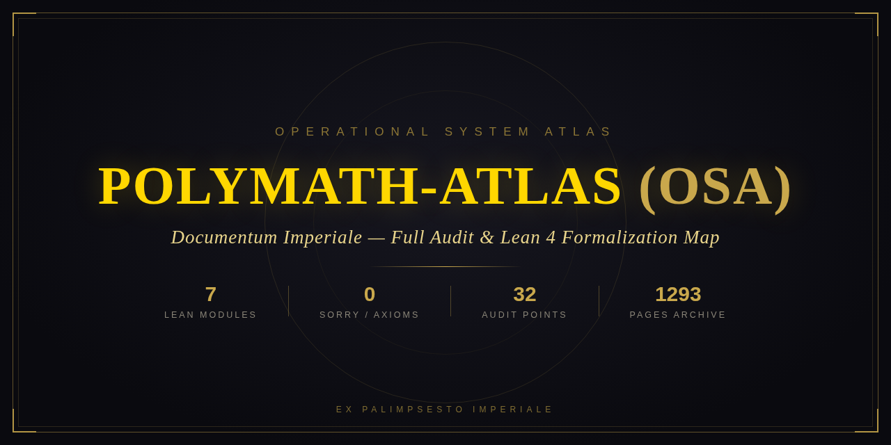
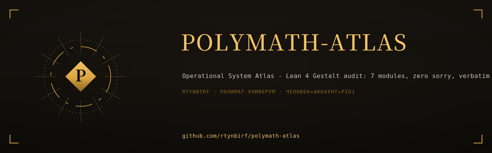
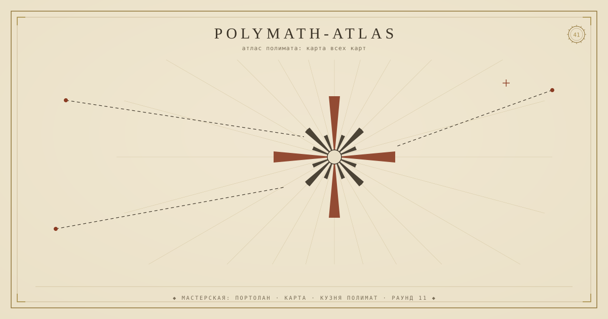
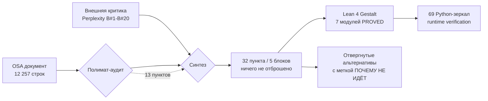

<div align="center">



# POLYMATH-ATLAS (OSA) · Documentum Imperiale

<div align="center">
  
</div>

<!--ФОРЖ:МУЗА:НАЧАЛО-->
<div align="center">
  
  <br/>
  
</div>
<!--ФОРЖ:МУЗА:КОНЕЦ-->


**Operational System Atlas — полный аудит, вербатим-архив и карта Lean 4 формализации**

[](https://leanprover-community.github.io/)
[](docs/index.html)
[](docs/index.html)
[](docs/index.html)
[](.github/workflows/lean.yml)
[](LICENSE)
[](docs/index.html)

*Ex Palimpsesto Imperiale* — из имперского палимпсеста: ни одна строка не потеряна, ни одна не сокращена.

</div>

---

## ⚡ Суть за 30 секунд

**Polymath-Atlas (OSA)** — «операционный атлас»: синтаксическая машина, типизированная система из 5 уровней (L0–L4), 5 типов эффектов (E0–E4) и 11 операторов в JSON-матрице. Проект прошёл трёхступенчатый аудит мирового уровня:

1. **Собственный полимат-аудит** — 13 пунктов с отвержением альтернатив и обоснованием («почему не идёт») по каждому;
2. **Внешняя критика** (Perplexity) — 20 пунктов (B#1–B#20);
3. **Синтез без потерь** — единый аудит из **32 пунктов** (5 блоков), где отвергнутое включено с меткой «ПОЧЕМУ НЕ ИДЁТ», ничто не отброшено.

Ответ аудиту — **Lean 4 формализация `Gestalt`**: 7 модулей, доказанных без единого `sorry` и без единого пользовательского аксиомного пятна, плюс 69 исполняемых Python-зеркал в рантайме.

## 📜 Карта формализации Gestalt

| Модуль | Содержание | Ключевой результат | Статус |
|---|---|---|---|
| `UCC` | T1–T5: различение, прирост информации, ошибка обратной связи, инерция идеального предсказания, revisit по принципу Дирихле | T1–T5 формализованы | **PROVED** |
| `GenesisEngine` | L1–L7: Reactor, Compressor, Navigator с зазором EFE, Голографический монитор, Условия генезиса, Минимальный интеллект, Событие генезиса | зазор EFE операционализирован функционалом | **PROVED** |
| `SelfReference` | Методология v-уровней, Ω как неподвижная точка, «идеал = смерть» | `isOmega_of_step_fixed`; `gap_closed_iff_dead` | **PROVED** |
| `MetaSkills` | Метакognition = калиброванный + обоснованный отчёт | `prompt_cannot_install_metacognition`; агент-Идиот | **PROVED** |
| `ToolInventory` | Инвентарь из **28** инструментов (не 30, как в неформальном тексте — расхождение задокументировано, не спрятано) | дефицит инструментария Идиота доказан | **PROVED** |
| `AristotleCanon` | Статистика корпуса, канон с горизонтом | `no_fixed_point`; канон блокирует T4 и сохраняет зазор | **PROVED** |
| `CoreBridge` | Связующее: EFE-функционал закреплён, накопленный EFE-след, свидетель существования Ω, рефлексивный агент | 7 пунктов `LEMMA_ADDED` | **PROVED** (lemma-bridge) |

**Аксиомный след:** только стандартные аксиомы Lean — `propext`, `Classical.choice`, `Quot.sound`. Ноль пользовательских аксиом.

**Статусная палитра:** `PROVED` · `LEMMA_ADDED` (лемма принята как шаг доказательства) · `HYPOTHESIS-RELATIVE` (постулат как поле структуры, не аксиома) · `BOUNDARY` (граница формализации — честно помечена).

## 🗝 Что здесь есть такого, чего нет ни у кого

| # | Артефакт | Чем уникален |
|---|---|---|
| 1 | **[Имперский архив всех сессий](docs/index.html)** | 54 296 строк / 2.9 MB исходных сессий, перенесённых **verbatim** — не сокращено, не сжато, не пересказано. Тёмная имперская вёрстка с золотом. Разворачивается как GitHub Pages одной галочкой |
| 2 | **[PDF «Documentum Imperiale»](archive/POLYMATH_ATLAS_ALL_SESSIONS_IMPERIAL.pdf)** | 1293 страницы, векторный текст, та же имперская тема |
| 3 | **Аудит-таблица «дыра → доказательство»** | Каждая неформальная претензия прослежена до Lean-теоремы или честно помечена `BOUNDARY` |
| 4 | **Отвергнутые альтернативы** | Не удалены, а сохранены с обоснованием «ПОЧЕМУ НЕ ИДЁТ» — методологическая честность как артефакт |
| 5 | **Готовый CI для Lean** | Официальный [`leanprover/lean-action`](https://github.com/leanprover/lean-action) уже настроен: положите `Gestalt/` — сборка и проверка `sorry` запустятся сами |

## 🔬 Методология аудита (без потерь)



Примеры трассировки «претензия → формализация»:

| Неформальная претензия | Ответ формализации |
|---|---|
| «EFE — просто строка-заглушка» | EFE-зазор операционализирован функционалом в `GenesisEngine` / `CoreBridge` |
| «Ω — необоснованная метафора» | Ω — теорема о неподвижной точке: `isOmega_of_step_fixed` |
| «Идеал-состояние недостижимо, но это не сказано» | Доказано как `gap_closed_iff_dead` («идеал = смерть») |
| «Метакогницию нельзя "прошить" промптом» | Теорема `prompt_cannot_install_metacognition` |
| «Инвентарь инструментов выдуман» | Посчитан честно: 28, расхождение с «30» задокументировано |
| «Модели времени/ресурсов/агента нет» | Помечено `BOUNDARY` — граница формализации не скрывается |

## 🚀 Быстрый старт

```bash
# 1. Клонировать
git clone https://github.com/rtynbirf/polymath-atlas.git
cd polymath-atlas

# 2. Открыть имперский архив (локально)
open docs/index.html          # macOS
xdg-open docs/index.html      # Linux

# 3. Прочитать PDF-версию
open archive/POLYMATH_ATLAS_ALL_SESSIONS_IMPERIAL.pdf
```

### Включить GitHub Pages (витрина архива)

`Settings → Pages → Deploy from a branch → main / (root)` — workflow `.github/workflows/pages.yml` уже в репозитории. Архив откроется по адресу `https://rtynbirf.github.io/polymath-atlas/`.

### Подключить Lean-формализацию

Папка `Gestalt/` с 7 модулями кладётся в корень рядом с `lean-toolchain` — CI `lean-action` подхватит её автоматически (workflow сконфигурирован условно и не падает, пока Lean-файлов нет).

## 🗺 Карта репозитория

| Путь | Что это |
|---|---|
| `docs/index.html` | Имперский архив всех сессий (вербатим, GitHub Pages) |
| `archive/…IMPERIAL.pdf` | 1293-страничная PDF-версия архива |
| `assets/social-preview.png` | Social preview 1280×640 (положить в Settings → Social preview) |
| `docs/osa-document.txt` | Исходный документ OSA (12 257 строк) |
| `docs/external-critique.txt` | Внешняя критика (Perplexity, B#1–B#20) |
| `.github/workflows/lean.yml` | CI: сборка Lean 4 через lean-action |
| `.github/workflows/pages.yml` | CI: деплой витрины на GitHub Pages |
| `DEPLOY.md` | Пошаговый деплой за 10 минут (безопасный) |

## 🛡 Правила этого репозитория

- **Ничего не удаляется.** Отвергнутое помечается и сохраняется.
- **Ничего не выдумывается.** Статусы берутся из отчётов формализации; граница (`BOUNDARY`) — это признак честности, а не слабости.
- **Секреты не попадают в репозиторий.** Токены — в `gh auth login` или credential manager, никогда в файлы и URL.

## 📄 Лицензия

MIT — см. [LICENSE](LICENSE). Документы-источники принадлежат их авторам и включены в архив в исследовательских целях.

<div align="center">

**Documentum Imperiale** · *Ex Palimpsesto Imperiale*

«Ни одна строка не потеряна. Ни одна претензия не осталась без ответа — доказанным или честно помеченным.»

</div>

<!--ФОРЖ:ПОДВАЛ-->
---

<div align="center">
  <sub>◆ картина и штандарт — ручная ковка <a href="https://github.com/rtynbirf">КУЗНИ ПОЛИМАТ</a> · ЧЕЛОВЕК=АККАУНТ=PID1 ◆</sub>
</div>
